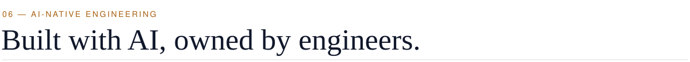

<picture>
  <source media="(prefers-color-scheme: dark)" srcset="./assets/hero-dark.svg">
  
</picture>

 

 

### Hi, I'm *Arman.*

I'm **Md. Arman Morshed**, a lead software engineer with six years of building scalable iOS apps. At **Brain Station 23** I lead the Clean Architecture migration of **MyGP**, Grameenphone's self-care app, inside a multi-squad team.

I work in Swift, SwiftUI and UIKit, with The Composable Architecture, Clean Architecture and MVVM. Before this I designed iOS architecture from scratch at Monstarlab, did R&D on visionOS, and started out at WellDev. I care about code that's fast, tested and easy for the next engineer to pick up, and I use AI across the development lifecycle to get there faster.

> *“From the first commit to the App Store.”* One engineer. The whole journey.

<picture>
  <source media="(prefers-color-scheme: dark)" srcset="./assets/stats-dark.svg">
  
</picture>

 

#### The toolkit

           

 

<picture>
  <source media="(prefers-color-scheme: dark)" srcset="./assets/h-work-dark.svg">
  
</picture>

<table>
<tr>
<td width="96" align="center"></td>
<td>
<h3><a href="https://apps.apple.com/us/app/mygp-bangladesh/id1128691313">MyGP</a> &nbsp;Flagship · Grameenphone</h3>
Grameenphone's self-care app for recharge, balance, packs, bills and rewards, rated <b>4.5★ from 109K</b> App Store ratings.  
⚡ <b>60–65% faster</b> MyGP app load time after the migration. 
🧭 <b>Led</b> the Clean Architecture flow for the iOS team.  
<code>Swift</code> <code>UIKit</code> <code>Clean Architecture</code> <code>Coordinators</code>
</td>
</tr>
<tr>
<td align="center"></td>
<td>
<h3><a href="https://apps.apple.com/us/app/welltravel/id1403762062">Welltravel</a></h3>
A corporate travel app for Welltravel International AG that connects travellers, travel agencies and travel managers. Deals on flights, hotels and cars, in-policy booking, travel documents, expenses and in-app chat.  
<code>Swift</code> <code>iOS</code> <code>Travel</code>
</td>
</tr>
<tr>
<td align="center"></td>
<td>
<h3><a href="https://apps.apple.com/us/app/motf-navigator/id6449295385">MOTF Navigator</a></h3>
The official companion app for Dubai's Museum of the Future, in English and Arabic. Visitors scan exhibits into collectible cards, unlock hidden content, and keep a personal map of their visit.  
<code>Swift</code> <code>iOS</code> <code>English / Arabic</code>
</td>
</tr>
<tr>
<td align="center"></td>
<td>
<h3><a href="https://www.muslistings.com/">MusListings</a> &nbsp;iOS app publishing soon</h3>
Where faith meets convenience. A listings app that helps Muslim communities find and share the services they need.  
<code>Swift</code> <code>SwiftUI</code> <code>iOS</code>
</td>
</tr>
<tr>
<td align="center"></td>
<td>
<h3><a href="https://play.google.com/store/apps/details?id=com.bayaanapp&hl=en">Bayaan</a> &nbsp;iOS app publishing soon</h3>
An Islamic lifestyle app that plays the Adhan on Google Nest and Amazon Alexa speakers, works out prayer times from your location, and schedules Sunnah routines and daily reminders.  
<code>Swift</code> <code>iOS</code> <code>Smart home</code>
</td>
</tr>
</table>

 

<picture>
  <source media="(prefers-color-scheme: dark)" srcset="./assets/h-journey-dark.svg">
  
</picture>

| | |
|---|---|
| **2024 — now** Jun 2024 – Present | **Lead Software Engineer** · Brain Station 23 PLC Lead the Clean Architecture migration of the MyGP iOS app, which cut the app's load time by roughly 60–65%. Implemented the Family Plan feature, which brings in 4.31M in incremental revenue every month. Run code reviews and team meetings, and turn business goals into deliverables. |
| **2021** Feb 2021 – May 2024 | **Software Engineer** · Monstarlab Bangladesh Designed iOS app architecture from scratch on The Composable Architecture. Delivered well-tested features across client projects with QA and product teams, and did R&D on visionOS. |
| **2019** Sep 2019 – Jan 2021 | **Junior Software Engineer** · WellDev Bangladesh Ltd. Worked with QA, backend and scrum teams to improve API integration quality, and delivered client-requested features. |
| **Education** | **BSc, Computer Science & Engineering** · Ahsanullah University of Science and Technology **ACMP 4.0** · IBA, University of Dhaka |

 

<picture>
  <source media="(prefers-color-scheme: dark)" srcset="./assets/h-ai-dark.svg">
  
</picture>

I work in the **AI-Driven Development Lifecycle (AI-DLC)**. AI agents plan, ask questions and write code in short bolts. I review, decide and own what ships.

| 01 · Inception | 02 · Construction | 03 · Operations |
|---|---|---|
| Intent becomes requirements, questions and units of work, validated by the team. | AI drafts domain models, code and tests against Clean Architecture. I review every diff. | Release notes, crash triage and follow-up fixes, fed back into the next bolt. |

 

<picture>
  <source media="(prefers-color-scheme: dark)" srcset="./assets/h-contact-dark.svg">
  
</picture>

Have an app, a tangled codebase, or a team that cares about great iOS experiences? Let's talk.

📮 **[arman.morshed98@gmail.com](mailto:arman.morshed98@gmail.com)** &nbsp;·&nbsp; 📞 **+880 1775 312688** &nbsp;·&nbsp; 📍 Dhaka, Bangladesh

 
<i>Clean architecture. Thoughtful engineering.</i> &nbsp;·&nbsp; <a href="https://ar-morshed.github.io">ar-morshed.github.io</a>

